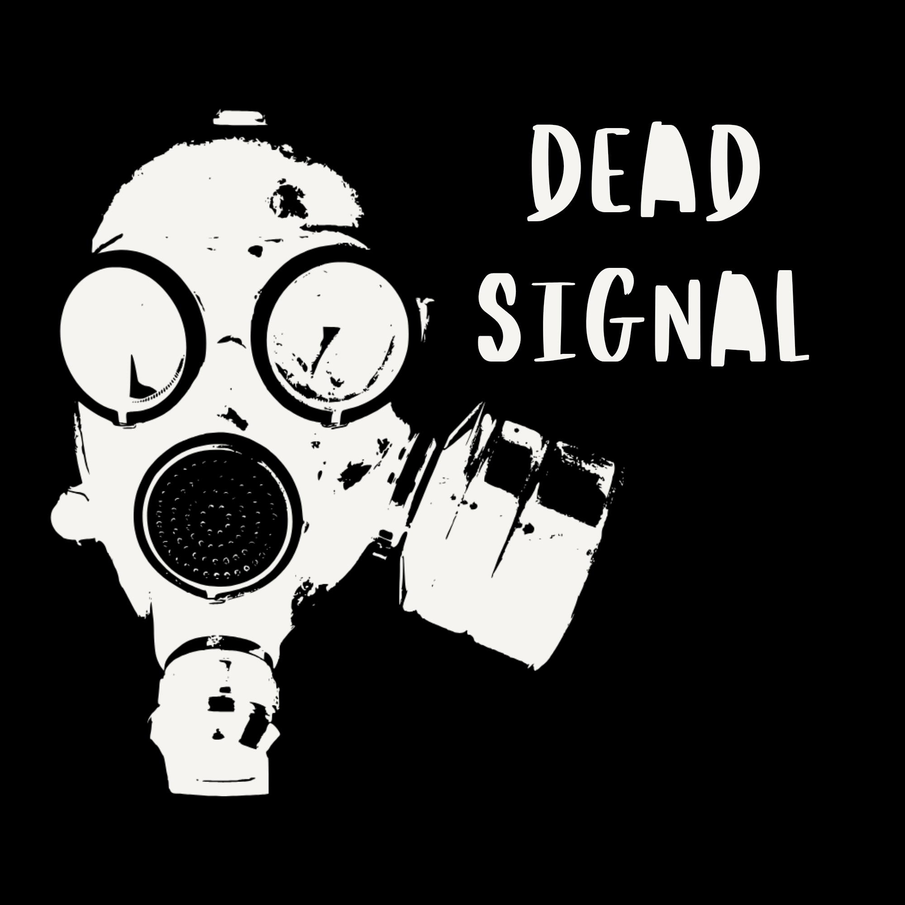

DEAD SIGNAL

<p align="center">
  
</p><p align="center">
  <strong>One room. One decision. A nation's fate.</strong>
</p><p align="center">
  A stylized 3D Cold War command-room game set in a fictional world around 1985.
</p><p align="center">
  
  
  
  
  
</p>---

About

DEAD SIGNAL is an atmospheric, Cold War-inspired strategy and decision-making game.

You are an operator in an underground military command facility belonging to Norvak. Surrounded by CRT monitors, analogue controls, and unreliable communications, you must make critical decisions while a war unfolds beyond your walls.

You have the authority to launch missiles without waiting for another person's approval. But authority does not guarantee certainty, and every decision can carry consequences.

Will you follow orders, question them, or decide for yourself?

Features

- Immersive command room — A confined underground facility with a gritty, stylized 3D aesthetic.
- Military communications — Receive orders, reports, and warnings.
- Battlefield monitoring — Inspect a fictional tactical map and radar information.
- Strategic decisions — Make choices under uncertainty.
- Missile launch sequences — Witness launches through the reinforced observation window.
- Consequential gameplay — Influence the battlefield and the fate of Norvak.
- Multiple endings — Your performance and decisions shape the outcome.

Most of these exist in prototype form; see the roadmap below.

The World

The game takes place around 1985 in a fictional world where Norvak is fighting an alliance of three neighbouring powers.

- Norvak — A northern industrial republic.
- Dravonya — An eastern power with a massive army and heavy artillery.
- Ostrev — A mountainous nation with a focus on air superiority.
- Merovia — A western coastal power with a strong navy.

The world and its history will be expanded as development progresses.

Art Direction

DEAD SIGNAL combines stylized 3D environments with a gritty retro military aesthetic.

- Worn concrete and scratched metal.
- Green phosphor CRT displays.
- Amber indicators and red critical warnings.
- Analogue switches, military telephones, and mechanical gauges.
- Controlled darkness, strong shadows, and subtle environmental effects.

The goal is to create an oppressive atmosphere without sacrificing readability on mobile devices.

Technology

- Engine: Godot 4
- Language: GDScript
- Target platform: Android
- Rendering: 3D
- Development approach: Small, testable iterations

Roadmap

- [x] Create the initial Godot project.
- [x] Build the 3D command room and the limited seated camera.
- [x] CRT displays and analogue control panels.
- [x] Interactions and focus mode.
- [x] Main menu, persisted settings, pause menu.
- [x] Opening cinematic.
- [x] Communications: orders, status and field reports, intercepts, calls.
- [x] Fictional tactical map and radar interfaces.
- [x] Missile launch sequence.
- [x] Decision consequences, three endings, after-action report.
- [x] Procedural placeholder sound design (audio-first notifications).
- [ ] Russian voice recordings for all dialogue (slots and subtitles in place).
- [ ] Recorded sound effects and music to replace the placeholders.
- [ ] Profiling on more Android devices.

Playing

**Main menu** (the entry screen): `CONTINUE` (only when a shift is saved), `NEW GAME`, `SETTINGS`, `CREDITS`, `EXIT`.

**NEW GAME** plays the opening cinematic (about 85 s, skippable with two taps on `SKIP` or the Android back gesture): a briefing in front of a whiteboard of the three enemy fronts, a report quietly set aside, radio traffic that does not match the briefing. Then the operator is alone at Launch Control Post K-4 as the screens warm up. There is no mission select; the shift simply begins.

**One continuous shift.** There are no days or missions. Traffic and orders keep arriving until one of three endings. The game saves automatically (after every decision and event, every 30 s, and when the app is paused or closed); `MENU` → `SAVE AND EXIT TO MENU` returns to the menu, and `CONTINUE` resumes exactly where you left off without repeating anything.

The first part, **SILENT FRONT** (about 9 minutes, no launch authority), is a routine shift: Central reports the Karsen sector as controlled, but its basis is a field report from the previous evening, the line to Karsen is dead, and a radio fragment says otherwise. You can check timestamps, sources and verification, and request confirmation. The answer never quite comes.

After that, **orders** arrive one by one on the teleprinter. They get harder and less clear. Each has a reply deadline (no reply is recorded as such). Consequences often surface several orders later. Refusing is not always right, and neither is obeying. Fire missions grant launch authority for one grid and a maximum category only.

How it works:

- **Audio first.** The printer motor, the telephone bell, radio static or the CRT alert tone is heard before any lamp, notice or text appears. Notices sit at the screen edge (`! ORDER ...`, `TELEPRINTER: n UNREAD`), never in the middle.
- **Teleprinter / reader.** Tap the teleprinter or a notice to read. A report shows its reference, type, time, source, source id, verification, basis, conflicts, age and confirmation state. `REQUEST CONFIRMATION` and `FORWARD TO COMMAND` appear where they apply. `LOG` lists all traffic, newest first.
- **Telephone.** When it rings, tap it to answer (the call is subtitled with its caller). Unanswered calls are logged as missed.
- **Radio.** While the RX lamp flickers with live traffic, tap the radio to listen.
- **Orders.** `ACCEPT` / `REFUSE` need a confirming second tap. The decision is stamped, recorded and cannot be changed.
- **Launch.** As before (map knobs → `CONFIRM GRID` → `S`/`M`/`L` → KEY → MASTER twice), but only within an accepted fire order's grid and category.

**Endings.** Exactly three, decided by the hidden state of the run (command trust, front stability and information integrity), never selectable: relieved of duty; Varnesk falls; Norvak survives. Each is followed by an **after-action report** that lists only what the game tracked: orders (followed, refused, no reply), reports and how many were unverified, confirmation requests, intercepts, calls, launches with their reported results, allocation units spent, beers and cigarettes. No casualty figures.

**The operator** talks rarely: tired, restrained, observant, now and then dry. Lines react to what happens (beer, cigarettes, silence, unanswered requests, approvals, reports) and reveal a few personal details slowly. One-time lines never repeat, even across saves.

**Beer and cigarettes** at the right corner of the main desk are purely atmospheric: no meters, bonuses or penalties, and no effect on any outcome. Each completed drink or cigarette is counted once (for the report). A second beer in a row gives one very slight, brief camera shake (none with reduced motion).

Map conventions: one fixed fictional sheet (160 x 120 km, north up). Grid squares are 40 km (`P`-`S` west to east, `R`-`T` north to south) split into 4 km cells numbered by easting then northing (counted from the square's south edge). `RS-27` is the cell 88-92 km east, 48-52 km south, 12 km east of Karsen Junction. Varnesk lies off this sheet to the west. Reported intelligence is shown dashed in amber and is not confirmed; what is really there is only revealed by events. Zoom is anchored on the cursor.

Controls

| Action | Touch (Android) | Desktop |
| --- | --- | --- |
| Look around (limited) | Drag anywhere | Left-mouse drag |
| Turn to comms / status station | `< COMMS` / `STATUS >` buttons | `A` / `D` or arrow keys |
| Face the main console again | `CONSOLE` button or double-tap empty space | Double-click, `R`, `Space` or `Home` |
| Use a control / lean in to a screen or panel | Tap it | Click it |
| Turn a desk knob | Circle it with a finger | Circle it with the mouse |
| Leave a focused view / close a sheet | `< BACK`, double-tap empty space, or Android back | `Esc` |
| Pause, settings, save and exit | `MENU` (top left) or Android back | `MENU` |

The view turns about 80° to either side and tilts slightly. The operator cannot stand, walk or turn around. A press that moves is always a look-drag; only a short tap interacts, and on-screen buttons never turn the view.

Interactive objects

| Where | Object | Response |
| --- | --- | --- |
| Main desk | Three CRT screens | Lean in (focus). Map: physical controls only. Control: `SMALL` `MEDIUM` `LARGE` `ABORT` `CLEAR`. Radar: `RANGE` |
| Main desk | Map navigation unit | Cursor X/Y, zoom, pan trackball, layer selector and on/off, confirm grid |
| Main desk | Push buttons, KEY, MASTER | Ammunition, abort, arming, launch |
| Main desk | Beer bottles, cigarette pack | Drink / smoke (atmosphere only) |
| Comms | Telephone | Answers a ringing call; otherwise lifts / hangs up |
| Comms | Radio transceiver | Listens to live traffic; otherwise cycles channels |
| Comms | Teleprinter | Opens the pending order, the newest unread item, or the log |
| Comms | Communication lines panel | Lean in; six line switches |
| Comms | Wall clock | Facility time (05:40 at shift start) |
| Status | Facility status panel | Lean in; breakers move their power meters |

Settings

All settings are saved on the device immediately (`user://settings.cfg`) and are available from the main menu and the in-game `MENU`.

- **Graphics:** AUTO / LOW / MEDIUM / HIGH (also the quick `GFX` button in the room).
- **Audio:** Master, Music, SFX and Voice volumes (separate audio buses).
- **Subtitles:** on/off and size. Subtitles are English; dialogue is written to be spoken in Russian. Until a line has a recording, its subtitle is always shown.
- **Controls:** camera sensitivity, invert vertical, reduced motion (no camera sway or shake, no light flicker).

Graphics quality

| Preset | MSAA | 3D render resolution | Key-light shadow | Glow | Accent / desk lamps | Radar redraw |
| --- | --- | --- | --- | --- | --- | --- |
| HIGH | 2x | native | on | on | on / on | 30 Hz |
| MEDIUM | off | capped at ~1.6 Mpx, upscaled | on | off | on / on | 20 Hz |
| LOW | off | capped at ~0.9 Mpx, upscaled | off | off | off / off | 12 Hz |

Only rendering cost changes: HUD, CRT content, map layers, controls and gameplay are identical on every preset; LOW also skips the cigarette smoke particles. The pixel cap follows the device's screen size. **AUTO** starts at MEDIUM on Android (HIGH on desktop), measures the frame rate in the command room, and steps down (at most twice) if it stays under 40 FPS.

Audio and voice

Sound effects in `assets/audio/sfx/` are synthesised placeholders generated by `tools/gen_sounds.py` (no third-party recordings). Replace any of them with a recorded `.wav` of the same name. No voices are synthesised: dialogue lines have voice slots at `assets/audio/voice/ru/<line id>.ogg` (ids in `scripts/data/dialogue_lines.gd` and the cinematic's `LINES` table). Drop a recording in and it plays on the Voice bus with its English subtitle.

Getting the APK onto a phone (no desktop needed)

1. Every push to this repository runs the "Android APK" GitHub Actions workflow.
2. On GitHub, open the **Actions** tab → the latest **Android APK** run → download **DeadSignal-debug-apk** under *Artifacts*.
3. Unzip it on the phone and open `DeadSignal-debug.apk`. Android will ask you to allow installing from that app (browser or file manager) once.
4. If an update refuses to install over an older build, uninstall the old one first (debug builds may be signed with different keys).

Opening the project in an editor

- **Android:** install the official *Godot Engine 4* editor (4.5 or newer) from Google Play, clone or download this repository to the phone, then *Import* the folder containing `project.godot`.
- **Desktop:** Godot 4.5+ → *Import* → select `project.godot` → press *Run* (F5).

The renderer is *Compatibility* (OpenGL ES 3) for the widest range of Android phones. Opening `scenes/main.tscn` directly runs the room as a sandbox (no scenario; the first order arrives after ten seconds).

Project Structure

```
project.godot              Engine settings, autoloads
scenes/main_menu.tscn      Entry point: terminal-style menu
scenes/intro.tscn          Opening cinematic (briefing room)
scenes/main.tscn           The command room
scenes/epilogue.tscn       "Norvak survives" epilogue
scenes/after_action.tscn   After-action report
scripts/core/settings.gd   Player settings + audio buses (autoload Settings)
scripts/graphics_settings.gd Rendering presets (autoload Graphics)
scripts/core/audio.gd      Sound effects, loops, voice playback (autoload Sfx)
scripts/core/subtitles.gd  Speaker-labelled subtitles (autoload Subtitles)
scripts/core/run_state.gd  The run: hidden values, traffic, requests, decisions,
                           habits, statistics, save/load (autoload Run)
scripts/core/dialogue.gd   Operator dialogue manager (autoload Dialogue)
scripts/data/dialogue_lines.gd The operator's line library
scripts/data/scenario.gd   SILENT FRONT beats, order schedule, consequences
scripts/order_catalog.gd   Order texts, effects, launch authority
scripts/game/director.gd   Runs the shift: cues, beats, orders, consequences, assessment
scripts/game/endings.gd    The three endings
scripts/cinematic/         Opening cinematic and epilogue
scripts/ui/                Menu, settings, pause, after-action report, shared style
scripts/vices.gd           Beer and cigarettes
scripts/message_reader.gd  Orders, reports and the traffic log on paper
scripts/comms_station.gd   Telephone, radio, teleprinter, clock
scripts/strategic_state.gd Shared map/target/launch state, authority
scripts/map/               Map grid, geography, knowledge queries, renderer
...                        Room, stations, camera, CRTs, launch (as before)
tools/gen_textures.py      Placeholder textures
tools/gen_sounds.py        Placeholder sound effects
assets/flags/              Approved country flags (unchanged originals)
```

Project Status

Playable from menu to ending. Placeholder audio, no voice recordings yet. All countries, places, units and weapons are fictional; launches and their results are abstract.

License

No license has been selected yet. All rights are reserved by the project owner unless stated otherwise.

---

<p align="center">
  <em>DEAD SIGNAL — The order is yours. The consequences are not.</em>
</p>
